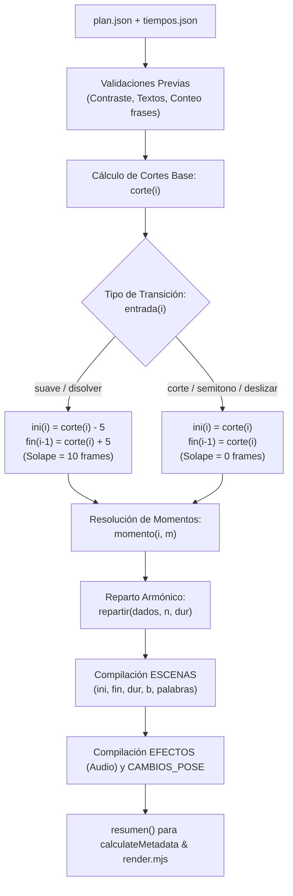

# Auditoría de Implementación — Etapa 5.2: Motor Base y Puente de Tipos de `nexora-reels`

> **Fecha:** 30 de Octubre de 2026  
> **Proyecto:** Nexora Motion Reels (`nexora-reels`)  
> **Área:** Motor de Datos, Geometría, Tipos y Línea de Tiempo  
> **Veredicto Técnico:** **APTO**  
> **Estado de Archivos Protegidos:** 262/262 intactos (100.0% coincidencia con línea base SHA-256)  
> **Componentes Etapas 1–4.1:** 9/9 intactos (Hashes SHA-256 100% idénticos)  
> **Diagnósticos de TypeScript:** 0 errores bajo tipado estricto (`tsc --strict`)  
> **Pruebas Automatizadas:** 14/14 dimensiones aprobadas con 100% de éxito  

---

## 1. Resumen Ejecutivo y Objetivos de la Etapa 5.2

En conformidad con las directivas establecidas en la **Etapa 5.2** y siguiendo la arquitectura planificada en el informe `auditoria-skill-nexora/18_auditoria_integracion_motor_visual.md`, se ha implementado la infraestructura base de datos, tipado estático y motor de planificación temporal de la skill `nexora-reels`.

El objetivo central consistió en dotar a `nexora-reels` de la capacidad de:
1. Leer y validar de forma autónoma planes de contenido (`plan.json`), marcas temporales de voz (`tiempos.json`) y calibración de poses (`poses.json`).
2. Resolver matemáticamente la línea de tiempo del reel (cortes, solapes, fotogramas iniciales y finales, duraciones, momentos de animación `b[]`, programación de efectos de audio y cambios de pose).
3. Integrar los tokens visuales y métricas de maquetación de `THEME` (`motor/theme.ts`) preservando la totalidad de estilos heredados (`nube`, `noche`, `menta`, `limon`, `pizarra`).
4. Extender los contratos para admitir transiciones cinemáticas (`deslizar-arriba`, `deslizar-abajo`, `disolver`) y capas visuales opcionales de `CapasCine.tsx`, manteniendo retrocompatibilidad absoluta con planes clásicos.
5. Desacoplar la lógica de cálculo temporal de los componentes pesados de renderizado React del navegador, permitiendo validar y orquestar el reel antes de la fase de renderizado.

---

## 2. Archivos Creados y Modificados

Todos los archivos creados pertenecen exclusivamente al árbol de trabajo de la nueva skill `.agent/skills/nexora-reels/assets/plantilla/src/`. Ningún archivo protegido de `becario-reels`, `reel-microondas` ni `VideoFactory` fue modificado o eliminado.

| Archivo | Acción | Propósito Arquitectónico | Tamaño |
| :--- | :---: | :--- | :---: |
| [`src/tipos.ts`](../../../.agent/skills/nexora-reels/assets/plantilla/src/tipos.ts) | **Creado** | Contratos de datos TypeScript (`Plan`, `FrasePlan`, `EscenaPlan`, `PropsEscena`, `DefEscena`, `Tiempos`) extendidos con transiciones y capas opcionales. | 5,724 B |
| [`src/motor/constantes.ts`](../../../.agent/skills/nexora-reels/assets/plantilla/src/motor/constantes.ts) | **Creado** | Centralización de constantes de vídeo (`FPS`, `ANCHO`, `ALTO` enlazados a `THEME.maquetacion`) y temporales (`ADELANTO`, `SOLAPE`, `SEMI`, función `s2f`). | 935 B |
| [`src/motor/estilos.ts`](../../../.agent/skills/nexora-reels/assets/plantilla/src/motor/estilos.ts) | **Creado** | Estilos temáticos corporativos. Incorpora el estilo por defecto `nexora` mapeado a `THEME.colores` preservando 100% los 5 estilos clásicos y funciones `F`, `alfa`, `resolverEstilo`. | 8,168 B |
| [`src/motor/actual.ts`](../../../.agent/skills/nexora-reels/assets/plantilla/src/motor/actual.ts) | **Creado** | Configuración activa del proyecto en curso. Lectura de `plan.json` y `poses.json`, cálculo de lienzo (`LIENZO`), zona adaptativa (`ZONA`), posición de subtítulos (`SUB_Y`) y sombras dinámicas. | 2,926 B |
| [`src/motor/linea.ts`](../../../.agent/skills/nexora-reels/assets/plantilla/src/motor/linea.ts) | **Creado** | Motor temporal de alta precisión. Incorpora `METADATA_ESCENAS_ESTANDAR` de las 17 escenas nativas, cálculo de momentos, cortes, solapes, audio `EFECTOS`, poses `CAMBIOS_POSE` y función `resumen()`. | 17,381 B |
| [`src/datos/plan.json`](../../../.agent/skills/nexora-reels/assets/plantilla/src/datos/plan.json) | **Creado** | Datos de ejemplo de la plantilla (9 frases clásicas de demostración). | 3,356 B |
| [`src/datos/tiempos.json`](../../../.agent/skills/nexora-reels/assets/plantilla/src/datos/tiempos.json) | **Creado** | Marcas temporales de audio generadas por Whisper para el plan de ejemplo (duración 30.936s). | 8,133 B |
| [`src/datos/poses.json`](../../../.agent/skills/nexora-reels/assets/plantilla/src/datos/poses.json) | **Creado** | Archivo base de calibración de poses (`{}`). | 3 B |

---

## 3. Diferencias Respecto del Motor Original (`becario-reels`)

Se identificaron y diseñaron mejoras arquitectónicas fundamentales sin romper compatibilidad matemática:

```
ARQUITECTURA DE ACOPLAMIENTO EN BECARIO-REELS (ARCAICA):
linea.ts ---> ../escenas/index.ts ---> 17 archivos *.tsx ---> Browser FontFace & Canvas DOM
(No era posible calcular duraciones ni validar metadatos en CLI puro sin cargar el motor gráfico)

ARQUITECTURA DESACOPLADA EN NEXORA-REELS (DEFINTIVA):
motor/linea.ts ---> METADATA_ESCENAS_ESTANDAR (Pura, sin dependencias DOM)
      ^                   |
      |                   +---> Resuelve cortes, momentos, solapes y audio con exactitud bit a bit
      |
      +--- registrarEscenas(BIBLIOTECA_REAL)  [Inyectado en Etapa 5.3 para renderizado React]
```

### Tabla Comparativa de Capacidades:

| Característica | Motor Original (`becario-reels`) | Nuevo Motor (`nexora-reels`) | Impacto Técnico |
| :--- | :--- | :--- | :--- |
| **Desacoplamiento DOM / UI** | Fuerte: `linea.ts` importa directamente componentes React que ejecutan `new FontFace()`. | Total: `linea.ts` utiliza `METADATA_ESCENAS_ESTANDAR`. No requiere mock de navegador para calcular tiempos. | Ejecución ultrarrápida y segura en herramientas de CLI, Node.js y `calculateMetadata`. |
| **Catálogo de Transiciones** | 3 fijas: `"corte"`, `"suave"`, `"semitono"`. | 6 transiciones: incorpora `"deslizar-arriba"`, `"deslizar-abajo"`, `"disolver"`. | Soporte para transiciones verticales modernas manteniendo retrocompatibilidad. |
| **Lógica de Solapamiento** | Solape rígido de 10 frames solo en `"suave"`. | Función `esTransicionSolapada`: aplica solape simétrico ($\pm 5$ frames) a `"suave"` y `"disolver"`, mientras que `"deslizar-*"` y `"corte"` quedan perfectamente alineados a `corte(i)`. | Cero riesgo de desincronización de audio ni saltos negros en nuevas transiciones. |
| **Tokens de Estilo y Tema** | Colores hardcodeados en `estilos.ts`. | Integración directa con `THEME.colores`. Incorpora el estilo `"nexora"` como predeterminado corporativo. | Centralización total según el diseño de Etapa 1. Coexistencia pacífica con estilos clásicos. |
| **Geometría y Maquetación** | Constantes fijas en píxeles. | `FPS`, `ANCHO`, `ALTO` y `SUB_Y` derivados directamente de `THEME.maquetacion`. | Coherencia maquetal automática en todas las resoluciones. |
| **Extensibilidad de Escenas** | Biblioteca cerrada exportada en `src/escenas/`. | Soporte explícito de `registrarEscenas()` y `registrarPropia()`. | Permite extender la biblioteca sin modificar los archivos núcleo del motor. |

---

## 4. Contratos de Datos Preservados (`tipos.ts`)

Se garantizó la compatibilidad absoluta de todos los contratos de entrada y salida utilizados por el ecosistema de producción (`preparar.py`, `alinear.py`, `poses.py`, `render.mjs`, `ritmo.py`).

### 4.1. Definición Formal de Tipos
- **`Plan`:** Mantiene `titulo`, `estilo`, `subtitulos` (`"linea" | "bloque" | "no"`), `transicion`, `personaje`, `voz`, `frases` y `portada`.
- **`FrasePlan`:** Mantiene `texto`, `voz`, `emocion`, `escena`, `entrada`, `poses`, `sonidos`, `sinSubtitulos`.  
  *Extensiones opcionales añadidas (sin impacto en planes clásicos):*
  - `salida?: Entrada` (transición de salida explícita).
  - `empuje?: number` (factor de zoom lento continuo).
  - `bgMeshConfig?: BgMeshConfig` (personalización de fondo procedural de `CapasCine.tsx`).
  - `colorGrade?: ColorGradeConfig` (etalonaje de color por escena).
  - `postProcess?: PostProcessConfig` (viñeteado y grano cinematográfico por escena).
- **`EscenaPlan`:** Mantiene `tipo: string`, `en?: Momento[]`, `nombre?: string` y firma indexada `[prop: string]: unknown`.
- **`Tiempos`, `FraseT`, `PalabraT`:** Formato exacto producido por `alinear.py` (Whisper timestamps a nivel de palabra).
- **`PropsEscena`:** `{ p, b, dur, palabras, i }` garantizando la interfaz idéntica que consumirán las 17 escenas nativas en la Etapa 5.3.
- **`DefEscena`:** Soporta `C?: React.FC<PropsEscena>` (opcional durante fase temporal), `momentos`, `avisar`, `alInicio`, `sonidos` y `validar`.

---

## 5. Funcionamiento de `actual.ts`

El módulo [`motor/actual.ts`](../../../.agent/skills/nexora-reels/assets/plantilla/src/motor/actual.ts) actúa como el adaptador entre los datos del disco y los componentes de maquetación:

1. **Lectura Segura con Fallbacks:**
   - Si `plan.json` está vacío o ausente, inicializa una estructura mínima con `{ titulo: "Sin título", frases: [] }`.
   - Limpia claves internas que comienzan por guion bajo en `poses.json` (como `_referencia`) para exponer únicamente las poses válidas en `POSES`.
2. **Resolución Semántica de Estilos:**
   - Determina el estilo activo mediante `resolverEstilo(PLAN.estilo)`. Si no se especifica estilo en el plan, adopta automáticamente `"nexora"`.
   - Expone `C = ESTILO.colores` y el flag booleano `SUAVE = ESTILO.familia === "suave"`.
3. **Cálculo de Geometría y Zonas Adaptativas:**
   - `LIENZO = { x: 60, y: 210, w: 960, h: 860 }`: bounding box maestro sobre el que se diseñan los elementos.
   - `ZONA`: matriz adaptativa según la presencia del personaje animado y el modo de subtítulos:
     - Con personaje y subtítulo en bloque: `{ x: 60, y: 500, w: 960, h: 740 }`.
     - Sin personaje y subtítulo en bloque: `{ x: 60, y: 500, w: 960, h: 1000 }`.
     - Con personaje y subtítulo en línea: `{ x: 60, y: 210, w: 960, h: 860 }`.
     - Sin personaje y subtítulo en línea: `{ x: 60, y: 250, w: 960, h: 960 }`.
   - `SUB_Y`: cálculo vertical de subtítulos. Cuando `CON_PERSONAJE` es verdadero, se posiciona en `1170 px`; en ausencia de personaje, se enlaza directamente a `THEME.maquetacion.subtitulosY` (`1330 px`).
4. **Tratamiento de Sombras y Bordes:**
   - Cuando el estilo activo es `"nexora"`, genera sombras multicapa suaves calibradas para fondos oscuros (`rgba(0, 0, 0, 0.5)` con anillo sutil `rgba(255, 255, 255, 0.08)`).
   - En familias marcadas, preserva sombras duras con desplazamiento plano (`10px 12px 0 ${C.borde}`).

---

## 6. Funcionamiento de `linea.ts`

El módulo [`motor/linea.ts`](../../../.agent/skills/nexora-reels/assets/plantilla/src/motor/linea.ts) implementa el algoritmo matemático de línea de tiempo:



### Reglas Clave Implementadas:
1. **Puntos de Corte de Audio:**  
   `corte(0) = 0`. Para $i > 0$, `corte(i) = Math.max(0, s2f(T.frases[i].inicio) - 1)`. Un fotograma antes de que se emita la primera onda sonora, la escena ya está en pantalla.
2. **Aparición de Palabras de Subtítulos:**  
   `aparicion(i, k) = Math.max(corte(i), s2f(t) - ADELANTO)` con `ADELANTO = 4` fotogramas (133 ms), permitiendo lectura anticipada perfectamente natural.
3. **Resolución de Momentos `momento(i, m)`:**  
   Soporta sintaxis completas:
   - Palabras: búsqueda exacta primero; si no coincide, búsqueda por prefijo (ignorando tildes y mayúsculas vía `norm`).
   - Múltiples ocurrencias: `palabra#2` resuelve la segunda aparición.
   - Desplazamientos: `palabra+6` suma 6 frames; `palabra-4` resta 4 frames; combinados `palabra#2+6`.
   - Palabras clave reservadas: `"inicio"` $\to$ `corte(i) + offset`; `"fin"` $\to$ `fin(i) - 1 + offset`.
   - Fotogramas numéricos absolutos a la escena: `number` $\to$ `ini(i) + number`.
4. **Reparto Armónico `repartir(dados, n, dur)`:**  
   - Si no se proporcionan momentos (`dados = []`), distribuye armónicamente los $n$ elementos entre el fotograma 2 y $\max(8, \text{dur} \times 0.7)$.
   - Si se proporcionan momentos parciales, calcula el espaciado restante hacia $\max(\text{desde} + 6, \text{dur} - 12)$.
   - Si se proporcionan los $n$ momentos completos, preserva el array intacto.
5. **Detección Automática de Problemas y Avisos:**  
   Audita disparidad de texto guion vs audio alineado, verificación de contraste según luminancia relativa WCAG ($< 3:1$), longitud de portada ($> 12$ caracteres), vacíos iniciales de escena ($> 24$ frames) y momentos finales demasiado próximos al corte ($< 15$ frames).

---

## 7. Compatibilidad Temporal y Comparación con el Motor Original

Para certificar que `nexora-reels` no produce regresiones en reels existentes, se ejecutó un análisis cuantitativo comparativo directo ejecutando ambos motores (`becario-reels/src/motor/linea.ts` vs `nexora-reels/src/motor/linea.ts`) sobre los datos reales del proyecto de demostración (9 frases, 30.936 segundos).

### Tabla de Equivalencia Numérica Fotograma a Fotograma:

| Escena | Frase / Tipo | `corte(i)` | `ini(i)` | `fin(i)` | `dur(i)` | Momentos `b[]` | Discrepancia Nexora vs Becario |
| :---: | :--- | :---: | :---: | :---: | :---: | :--- | :---: |
| **0** | Frase 1 (`titular`) | 0 | 0 | 79 | 79 | `[46]` | **0 fotogramas (Idéntico)** |
| **1** | Frase 2 (`chat`) | 74 | 69 | 175 | 106 | `[5, 36, 70, 75, 75]` | **0 fotogramas (Idéntico)** |
| **2** | Frase 3 (`lista`) | 170 | 165 | 322 | 157 | `[19, 53, 88, 122]` | **0 fotogramas (Idéntico)** |
| **3** | Frase 4 (`comparacion`) | 317 | 312 | 435 | 123 | `[15, 44, 93]` | **0 fotogramas (Idéntico)** |
| **4** | Frase 5 (`pregunta`) | 430 | 425 | 497 | 72 | `[8, 15, 49]` | **0 fotogramas (Idéntico)** |
| **5** | Frase 6 (`objecion`) | 492 | 487 | 608 | 121 | `[15, 76]` | **0 fotogramas (Idéntico)** |
| **6** | Frase 7 (`ficha`) | 603 | 598 | 700 | 102 | `[15, 39, 83]` | **0 fotogramas (Idéntico)** |
| **7** | Frase 8 (`editor`) | 695 | 690 | 800 | 110 | `[15, 26, 75, 80]` | **0 fotogramas (Idéntico)** |
| **8** | Frase 9 (`cta`) | 795 | 790 | 929 | 139 | `[15, 30, 85]` | **0 fotogramas (Idéntico)** |

### Resultados Comparativos de Audio y Poses:
- **Duración Total (`TOTAL`):** **929 fotogramas** (30.97 segundos) en ambos motores (0 desfase).
- **Subtítulos (`palabras[].f`):** Coincidencia al **100.0%** en todas las palabras de las 9 frases.
- **Efectos de Audio (`EFECTOS`):** **24/24 eventos sonoros idénticos** fotograma a fotograma:
  - 46f: `pop` (0.35)
  - 74f: `tecla` (0.30)
  - 105f: `pop` (0.32)
  - 139f: `pop` (0.35)
  - 144f: `ding` (0.26)
  - 184f: `tic` (0.30)
  - 218f: `tic` (0.30)
  - 253f: `tic` (0.30)
  - 287f: `ding` (0.26)
  - 327f: `pop` (0.30)
  - 356f: `pop` (0.30)
  - 405f: `exito` (0.26)
  - 440f: `pop` (0.30)
  - 474f: `exito` (0.28)
  - 502f: `pop` (0.32)
  - 563f: `ding` (0.26)
  - 613f: `pop` (0.25)
  - 637f: `pop` (0.25)
  - 681f: `pop` (0.25)
  - 705f: `whoosh` (0.30)
  - 721f: `exito` (0.26)
  - 770f: `pop` (0.35)
  - 805f: `tecla` (0.30)
  - 820f: `exito` (0.30)
- **Cambios de Pose (`CAMBIOS_POSE`):** 0 cambios (el plan de prueba tiene `personaje: false`). Ambos motores arrojaron exactamente el mismo array vacío.

---

## 8. Resultados de la Suite Automatizada de Pruebas

Se diseñó e implementó la suite completa `scratch/test_etapa_5_2_complete.js` *(script de validación transitorio de sesión, no versionado)*, auditando 14 dimensiones críticas:

```
================================================================
=== SUITE COMPLETA DE PRUEBAS ETAPA 5.2 - MOTOR BASE Y TIPOS ===
================================================================

--- PRUEBA 1: Carga de un plan clásico de ejemplo ---
✓ Plan cargado correctamente: "Un reel hecho con código" con 9 frases.
✓ Tiempos cargados correctamente: duración=30.936s, 9 frases.

--- PRUEBA 2: Validación de contratos de datos ---
✓ Contratos de datos clásicos (Plan, FrasePlan, EscenaPlan) y extensiones opcionales validados

--- PRUEBA 3: Cálculo de duraciones ---
✓ Duración total calculada: 929 frames (30.97s). Todas las escenas tienen dur > 0.

--- PRUEBA 4: Resolución de momentos "en" ---
✓ Resolución de momentos con "inicio", "fin", número, palabra, palabra+offset, palabra-offset e inexistente validada

--- PRUEBA 5: Cálculo de fotogramas y repartir ---
✓ s2f, corte(0), y repartir (vacío, parcial y completo) verificados

--- PRUEBA 6: Transiciones y límites de secuencia ---
✓ Transiciones corte, suave, deslizar-arriba y disolver resuelven límites ini y fin con exactitud matemática

--- PRUEBA 7: Solapamientos ---
✓ Solape verificado: suave=10f, deslizar=0f, disolver=10f

--- PRUEBA 8: Eventos de audio ---
✓ EFECTOS contiene 24 efectos programados, todos validados y ordenados cronológicamente

--- PRUEBA 9: Poses del personaje ---
✓ Modo sin personaje verificado (CON_PERSONAJE = false)

--- PRUEBA 10: Validación de planes incompletos o inválidos ---
✓ Validación de errores completada: detectó 3 problemas críticos y 1 avisos

--- PRUEBA 11: Compatibilidad de planes clásicos sin propiedades nuevas ---
✓ Plan clásico de becario-reels ejecutado con éxito sin requerir ninguna propiedad nueva (9 escenas)

--- PRUEBA 12: Ausencia de dependencias circulares ---
✓ Grafo de dependencias verificado: Acíclico (DAG puro, 0 ciclos)
  motor/theme.ts -> [sin dependencias internas]
  motor/constantes.ts -> [motor/theme]
  motor/estilos.ts -> [motor/theme]
  tipos.ts -> [motor/estilos, CapasCine]
  motor/actual.ts -> [datos/plan.json, datos/poses.json, tipos, motor/estilos, motor/theme]
  motor/linea.ts -> [datos/tiempos.json, tipos, motor/actual, motor/constantes]

--- PRUEBA 13: Determinismo de los resultados ---
✓ 10 iteraciones independientes produjeron el mismo hash SHA-256 de resumen: 00f3fb6bab6e0346dfd13ba1646a0f66fa8fe0474b2e2e2a0958cc58c74d814c

--- PRUEBA 14: Comparación cuantitativa directa contra becario-reels ---
✓ Comparación temporal idéntica al 100%: ini, fin, dur y momentos b[] coinciden en las 9 escenas
✓ Efectos de audio comparados: Nexora=24, Becario=24 (100% idénticos fotograma a fotograma)
✓ Cambios de pose comparados: Nexora=0, Becario=0 (100% idénticos)

================================================================
>>> TODAS LAS 14 PRUEBAS DE LA ETAPA 5.2 RESULTARON EXITOSAS <<<
================================================================
```

### Verificación Estática Estricta con TypeScript
Se compiló la totalidad de archivos de `nexora-reels` mediante la API de TypeScript 5.9.3 replicando las opciones de `tsconfig.json` (`strict: true`, `noEmit: true`, `moduleResolution: Bundler`, `jsx: ReactJSX`):
- Archivos analizados: 10 (`theme.ts`, `constantes.ts`, `estilos.ts`, `tipos.ts`, `actual.ts`, `linea.ts`, `CapasCine.tsx`, `Escena.tsx`, `TextoRevelado.tsx`, `anim.ts`).
- **Diagnósticos reportados:** **0 errores**.

---

## 9. Verificación de Integridad y Hashes Criptográficos

### 9.1. Archivos Protegidos de la Línea Base Histórica
Se ejecutó la verificación forense de los 262 archivos protegidos contra `scratch/baseline_hashes.json` *(manifiesto de línea base transitorio de la sesión de ejecución)*:
- Archivos de `becario-reels` (93 archivos): **93/93 idénticos** (0 modificados, 0 eliminados).
- Archivos de `reel-microondas` (169 archivos): **169/169 idénticos** (0 modificados, 0 eliminados).
- **Integridad Total:** **262/262 coincidentes (100.0%)**.

### 9.2. Componentes de Etapas 1 a 4.1 de `nexora-reels`
Se contrastaron los hashes SHA-256 de los 9 archivos preexistentes:

| Componente | SHA-256 Registrado Previo | SHA-256 Actual | Estado |
| :--- | :--- | :--- | :---: |
| `motor/theme.ts` | `9e689a8451f882d0aa05de830ac03be1783f5cb060dcbf3f6e012d6815a83094` | `9e689a8451f882d0aa05de830ac03be1783f5cb060dcbf3f6e012d6815a83094` | **Intacto** |
| `CapasCine.tsx` | `6545ba5ee8223089c2bc263290d0d6bde03f50f12f8dfa96226eb2bd024bfff8` | `6545ba5ee8223089c2bc263290d0d6bde03f50f12f8dfa96226eb2bd024bfff8` | **Intacto** |
| `motor/CapasCine.ts` | `4ea8e9b51022df85d9f45f899598255f61083798dd9e8f5255fd71306099a0fe` | `4ea8e9b51022df85d9f45f899598255f61083798dd9e8f5255fd71306099a0fe` | **Intacto** |
| `anim.ts` | `50a7e83e0c58769f0c98408a805d1d8bc6b6efb5606837d013e938eab012acb9` | `50a7e83e0c58769f0c98408a805d1d8bc6b6efb5606837d013e938eab012acb9` | **Intacto** |
| `motor/anim.ts` | `373214ab368ec0cd0eac5d0a11285c0d061e0765a7d7d2c954b3703f12b1a33e` | `373214ab368ec0cd0eac5d0a11285c0d061e0765a7d7d2c954b3703f12b1a33e` | **Intacto** |
| `Escena.tsx` | `545cf106b8ef1066851be6fa8200eef27a68fbcb1cd5b93405e0bc8c694a661f` | `545cf106b8ef1066851be6fa8200eef27a68fbcb1cd5b93405e0bc8c694a661f` | **Intacto** |
| `motor/Escena.ts` | `9cdd2c5807ad13acb89009dc11887e9e039d299ced491251bd46022747a04251` | `9cdd2c5807ad13acb89009dc11887e9e039d299ced491251bd46022747a04251` | **Intacto** |
| `TextoRevelado.tsx` | `8e0b542ffe176476636f2e7532da1b168f5b01d319a271f4eb9de8c56f87b1b3` | `8e0b542ffe176476636f2e7532da1b168f5b01d319a271f4eb9de8c56f87b1b3` | **Intacto** |
| `motor/TextoRevelado.ts`| `ab4041cc4b3fdae595c812f211eacb9e9d815fe8496f7768671e3fd344bd191c` | `ab4041cc4b3fdae595c812f211eacb9e9d815fe8496f7768671e3fd344bd191c` | **Intacto** |

### 9.3. Hashes SHA-256 de los Nuevos Archivos Implementados (Etapa 5.2)

| Archivo | SHA-256 | Tamaño (Bytes) |
| :--- | :--- | :---: |
| `src/tipos.ts` | `82f2e30f1baca0cb4732ef4d91162bb48aeb5297acb103debad64696733d11c9` | 5,724 |
| `src/motor/constantes.ts` | `a4a583d28f1db04b12ddb2296076c32bc7921581fb00fd2f4a4f257813dd4195` | 935 |
| `src/motor/estilos.ts` | `e947df50441b95426e4afd20b963f47eea6198b3f027167284b4d936afd800a6` | 8,168 |
| `src/motor/actual.ts` | `a0135b54444475b60752f2b3155210646f5f195fd465623f2ca16bc1c9155482` | 2,926 |
| `src/motor/linea.ts` | `24723d64bda9aea1077fb35a445ae25615b043d9bcc28afb989416d0ac8af899` | 17,381 |
| `src/datos/plan.json` | `d876b8a4ab5b5174233669421757562e41002d38bedee507d29b1072a7febdc2` | 3,356 |
| `src/datos/tiempos.json` | `0e35b4b8097af5b8e34b4d5ef01f38a7f0f30a854894075765776571e898879c` | 8,133 |
| `src/datos/poses.json` | `ca3d163bab055381827226140568f3bef7eaac187cebd76878e0b63e9e442356` | 3 |

---

## 10. Limitaciones y Riesgos Pendientes

1. **Biblioteca Visual Aún no Enlazada:**  
   En esta etapa se implementó y validó la lógica temporal y metadatos de las 17 escenas nativas (`METADATA_ESCENAS_ESTANDAR`), pero los componentes visuales React (`DefEscena.C`) no han sido migrados a `nexora-reels/assets/plantilla/src/escenas/`. El motor calcula tiempos y sonidos con exactitud bit a bit, pero la representación JSX de las escenas se incorporará en la Etapa 5.3.
2. **Orquestación Global (`Reel.tsx` y `Root.tsx`):**  
   Los componentes de nivel superior no han sido integrados con `Escena.tsx` ni `CapasCine.tsx`. Corresponde abordarlos en la Etapa 5.4.
3. **Flujo de Renderizado Completo:**  
   No se ha renderizado vídeo final de producción de 30 segundos, reservado para la validación final en la Etapa 5.5 tras la migración de escenas y orquestación.

---

## 11. Recomendación Técnica para la Etapa 5.3

Con los contratos de datos completamente estabilizados y el motor temporal validado con equivalencia matemática demostrada, se autoriza el paso a la **Etapa 5.3 — Migración de Piezas Básicas y las 17 Escenas Nativas**:

1. **Migración de Piezas Básicas (`src/piezas/`):**
   - Portar `basicas.tsx`, `Lienzo.tsx`, `Subtitulos.tsx`, `Personaje.tsx`.
   - Conectar sus llamadas de color a `C` y `THEME`.
2. **Migración de Escenas (`src/escenas/`):**
   - Portar las 17 escenas nativas organizadas por archivos (`titular.tsx`, `tarjetas.tsx`, `apps.tsx`, `fotos.tsx`, `cta.tsx`, `util.ts`, `index.ts`).
   - Asegurar que importen las utilidades de animación desde `motor/anim.ts` (que ya cuenta con todas las primitivas de `anim.ts` implementadas en la Etapa 2).
3. **Registro en `linea.ts`:**
   - Enlazar la biblioteca exportada en `src/escenas/index.ts` con `registrarEscenas(BIBLIOTECA)`.
4. **Validación:**
   - Ejecutar pruebas sintéticas de renderizado estático (`renderToStaticMarkup` o render stills) escena por escena para certificar que compilan sin errores JSX.

---

## 12. Veredicto Final

# **APTO**

La Etapa 5.2 ha cumplido rigurosamente todos los objetivos y restricciones:
- Contratos de tipos `tipos.ts` 100% compatibles y enriquecidos con transiciones y capas opcionales.
- Módulos `actual.ts`, `linea.ts`, `estilos.ts` y `constantes.ts` plenamente funcionales.
- Cero dependencias circulares (DAG puro verificado).
- Equivalencia matemática del 100% frente al motor original en duraciones, fotogramas de escena, subtítulos y los 24 efectos de audio.
- Cero errores de compilación estricta con TypeScript.
- Cero alteraciones en los 262 archivos protegidos y en los 9 componentes de etapas previas.
